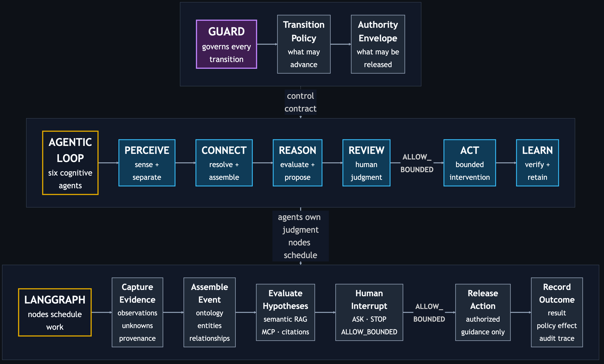

# Agentic Salmon — Python

- **Owner:** Joseph Shi — [aixstudio](https://github.com/aixstudio)
- **Role:** Principal Architect — Agentic AI & Data Platform
- **Created:** 2026-08-06 · **Updated:** 2026-10-18

Agentic Salmon demonstrates how an agentic system moves from uncertain evidence to human-approved guidance. Its architecture separates agent responsibilities, Guard authority, and workflow execution.

## Architecture at a Glance

The architecture is deliberately read top to bottom: Guard defines the control
envelope, the six agents own judgment, and the execution layer supplies
orchestration, knowledge tools, retrieval, and evidence capture.



[Diagram source](docs/diagrams/architecture.mmd)

Guard governs transitions and release authority across the agent sequence.
LangGraph schedules and checkpoints the contracts. Reason reaches reviewed
knowledge through MCP, so retrieval infrastructure can change without rewriting
Reason or the six-agent control model.

### What “orthogonal” means here

Orthogonal means a separate concern that applies across other components.
The six agents perform the work: Perceive → Connect → Reason → Review → Act →
Learn. Guard governs which transitions and actions may proceed throughout that
sequence. It is not a seventh stage.

The responsibilities are separate and interact through constraints: **agents
perform work; Guard constrains what may proceed**. The runtime schedules and
checkpoints that work. Python uses LangGraph; Go uses its native state machine.

## About This Implementation

I validate architecture through runnable code, explicit contracts, and behavioral
proofs. This implementation uses Python and its agent-workflow ecosystem.

> The agent refused to hallucinate dinner. That is when the architecture started working.

Python implementation; [native Go sibling](https://github.com/aixstudio/agentic-salmon-go).

Agentic Salmon is a locally runnable proof of controlled agentic architecture,
not a cooking application or a chat-wrapper demo. It turns one deliberately
ambiguous real-world observation into an auditable journey through evidence,
ontology, semantic retrieval, human authority, bounded action, and learning:

```text
GUARD ⊣ [PERCEIVE → CONNECT → REASON → REVIEW → ACT → LEARN]
```

Each name is an executable cognitive ownership boundary. Guard is not a seventh
agent; it controls which transitions and actions are permitted. LangGraph
schedules and checkpoints the six contracts and pauses at a real human Review
interrupt.


*Reviewed pre-cook input; food identity and safety remain unverified.*

## Logic Flow — One Run, Three Proofs

One case moves from evidence to human approval to a controlled response. Approval gives permission to proceed; it does not resolve missing facts. Keep the same run ID throughout, even if you close the terminal between steps. Full details are in `log/<run-id>.log`.


[Diagram source](docs/diagrams/logic-flow.mmd)

1. **Proof-1 — Show the evidence and pause.**

   **Known:** The evidence suggests fish, and supporting reference guidance is available.

   **Not known:** Food identity, ingredients and allergens, storage history, odor, and freshness and safety remain unverified. No response has been authorized.

   **Next:** Review the evidence, missing facts, and proposed limits. Continue to Proof-2 to approve or stop the saved case.

2. **Proof-2 — Let a person decide.**

   **Known:** Choosing `APPROVE` records permission to provide limited guidance backed by sources. Guidance has not yet been released.

   **Not known:** The same food facts remain unverified. Approval accepts those limits; it does not establish safety.

   **Next:** Continue to Proof-3 only after approval is saved. `STOP` or Enter ends the case without releasing guidance.

3. **Proof-3 — Deliver the approved guidance and close.**

   **Known:** The approved guidance is released, and a historical outcome and preference are recorded. Safety rules stay unchanged.

   **Not known:** The original missing facts remain unresolved. No new cooking or safety test has occurred.

   **Finish:** Expect `TEST END — PASS`. The demo is complete; inspect the log for detail. The completed case cannot release guidance again.


## Technology Stack and Rationale

| Technology | Role in this demo | Why it was chosen |
| --- | --- | --- |
| Python 3.13 | Typed local runtime and distributable package | Keeps the implementation readable, portable, and easy to inspect in VS Code while holding the demo to one validated runtime. |
| LangGraph `StateGraph` | State transitions, SQLite checkpoints, Review and pre-action interrupts, and durable same-run resume | Makes orchestration explicit and separates node scheduling from agent judgment. |
| Official LangGraph async SQLite checkpointer and proof phase claims | Durable Review and pre-action pickup across CLI invocations | Keeps the three proofs on one run ID and rejects wrong-order or repeated execution without a hosted approval service. |
| MCP Python SDK over stdio | Real client/server `search_knowledge` tool boundary | Proves that knowledge and future business tools are pluggable through a protocol boundary rather than embedded inside an agent. |
| FastEmbed with `BAAI/bge-small-en-v1.5` | Local dense embeddings for semantic retrieval | Demonstrates semantic RAG without an API key, hosted model, or keyword-only shortcut. |
| In-memory cosine ranking | Ranks the reviewed embedded chunks | Preserves the retrieval contract while avoiding a vector database that would add setup but no new architectural proof. |
| Reviewed JSON corpus and SHA-256 content digests | Self-contained knowledge sources, chunks, citations, and provenance | Identifies the exact cited text used by a run; content review and source authenticity remain separate responsibilities. |
| Typed Python models and a governed ontology | Stage artifacts, entity kinds, relationships, decisions, and authority | Turns the six agent names into testable contracts and rejects invalid semantic or control transitions. |
| JSON run logs, SQLite checkpoints, and `unittest` | Durable pickup, audit evidence, and deterministic contract tests | Gives an evaluator observable evidence without publishing prompts or hidden reasoning. |

## Why Python and Go

Python keeps LangGraph orchestration and FastEmbed dense semantic retrieval
close to their supported libraries. Go makes the same authority contracts
inspectable in a compiled runtime, with a native state machine, the official
Go MCP SDK, and self-contained lexical retrieval.

Both implementations preserve the six agent responsibilities, ontology, real
RAG/MCP boundary, SQLite-backed proof pickup, explicit human adjudication,
cited action, and policy-safe learning. Retrieval methods and packaging differ;
this is a shared contract demonstration, not a retrieval-quality or performance
comparison. The Go executable has no Python or LangGraph dependency.

## Why This Matters

Most agent demos emphasize whether a model can produce an answer. This demo
tests the harder architectural question: **should the system be allowed to act
on the evidence it actually has?** The photograph contains useful evidence, but
it does not prove identity, freshness, allergens, storage history, or safety.

The significant result is therefore not a clever food answer. It is a governed
system that preserves uncertainty, retrieves reviewed knowledge through a
replaceable interface, requires explicit human authority, cites the basis of
its bounded guidance, and prevents later outcome feedback from weakening its
safety policy.

## What the Demo Proves

| Demo point | Evidence to observe |
| --- | --- |
| Six owned agent contracts | The trace advances through Perceive, Connect, Reason, Review, Act, and Learn; each stage produces its own artifact. |
| Ontology-driven connection | Connect resolves mentions into typed entities and validates their relationships before reasoning proceeds. |
| Pluggable semantic RAG | Reason calls a real local MCP tool and returns the embedding model, ranked chunks, scores, citations, duration, and protocol metadata. |
| Human-in-the-loop authority | Review interrupts the graph and requires a valid working hypothesis, acceptance of retained unknowns, and explicit authorization. |
| Guarded action | An `unknown` hypothesis cannot authorize Act; only a supported or plausible selection can release bounded, cited guidance. |
| Policy-safe learning | Learn records outcome and preference evidence but cannot use a successful outcome to weaken safety or authority policy. |
| Auditability | The JSON result and local report expose timestamps, stage artifacts, decisions, retrieval evidence, and retained unknowns without exposing hidden reasoning. |

The RAG plug-in is intentionally small: a reviewed JSON corpus, FastEmbed dense
embeddings, and in-memory cosine ranking. It proves that semantic retrieval can
be plugged into the agent contract through MCP without requiring pgvector, a
hosted service, or credentials.

## Why the Implementation Is Intentionally Thin

The goal is architectural signal, not infrastructure volume. A larger stack
could hide the decisions being demonstrated behind cloud setup, databases, UI
frameworks, and vendor-specific services. This thin layer keeps the complete
control path visible and runnable on a laptop while retaining real seams:
agent contracts, ontology validation, LangGraph state and interruption, an MCP
boundary, semantic retrieval, authority policy, citations, and audit evidence.

Thin does not mean closed or domain-specific. It means the demonstration uses
the smallest implementation that preserves replaceable boundaries. To move into
another business domain, the architecture can evolve by replacing or expanding
the components behind those boundaries:

| Demo component | Scaled business-domain upgrade |
| --- | --- |
| Reviewed image fixture and provider | Domain events, documents, APIs, streams, or multimodal evidence with provenance |
| Kitchen ontology | A versioned domain ontology, entity-resolution service, and governed semantic model |
| JSON corpus and in-memory embeddings | Governed enterprise content, hybrid/vector retrieval, access control, reranking, and evaluation |
| One local MCP knowledge server | Multiple authenticated MCP servers and domain toolsets with scoped permissions |
| One node per agent contract | Multiple tools, models, workers, or subgraphs behind the same owned agent responsibility |
| CLI Review interrupt | Approval queues, case-management UI, policy service, and role-based authority |
| Local JSON run logs and SQLite checkpoints | Durable event storage, observability, compliance evidence, and continuous evaluations |

The stable architectural idea is the governed contract between evidence,
judgment, authority, and action. The infrastructure underneath each contract
can scale with the domain. This repository demonstrates that upgrade path; it
does not claim that the laptop-sized implementation is itself a production
enterprise platform.

## Evidence Boundary

No original packaging or label was available. The photograph supports visible
observations such as two portions, seasoning, skin, and the air-fryer basket. It
cannot establish species, ingredients, allergens, smell, storage history,
freshness, or safety. The human may select `fish` as the evidence-supported
working hypothesis while Reason keeps `salmon` separate and merely plausible.
Neither is treated as verified identity.

## Prerequisite — Python 3.13 Virtual Environment

Use Python 3.13.x for this demo. Python 3.14 is intentionally excluded until
the dependency set is validated against it.

On macOS with Homebrew:

```bash
brew install python@3.13
$(brew --prefix python@3.13)/bin/python3.13 -m venv --clear .venv
.venv/bin/python --version  # Expect Python 3.13.x
```

`--clear` safely replaces a `.venv` previously created with Python 3.14. If
Python 3.13 is already installed, `python3.13 -m venv --clear .venv` is
sufficient. Creating `.venv` is setup, not a demo step.

## Run the Three Incremental HITL Proofs

Install the local package from the repository root after creating the Python
3.13 environment:

```bash
.venv/bin/python -m pip install -e .
```

The first Proof-1 may download the configured embedding model. Retrieval and
model details go to the run log; terminal output remains focused on the proof.

Use the same run ID in all three commands. These proofs continue **one durable
run**, including after closing and reopening the terminal. For a repeat test,
use a new run ID in all three commands; existing runs are never overwritten.

### Proof-1 — Intentional pause for HITL

**Proof ID:** Proof-1

**Test Conditions:** Run from the repository root with a fresh `salmon-demo-001`
run ID. The reviewed image, fixture, and corpus are available. No approval has
been supplied. This step performs real retrieval across the MCP boundary.

**Test Cmd:**

```bash
.venv/bin/python -m agentic_salmon proof-1 --run-id salmon-demo-001
```

**What to Expect:** Perceive → Connect → Reason execute, then the system pauses
before Review. The terminal tells you what to review: evidence supports `fish`
as a working hypothesis, species remains unverified, all five unknowns must be
retained, and only cited bounded guidance may be authorized. Act/Learn do not
run. The checkpoint is saved in `log/salmon-demo-001.sqlite3`; detailed evidence,
retrieval results, citations, MCP metadata, timings, and state are recorded in
`log/salmon-demo-001.log`.

**What to Do Next:** Review the evidence boundary and requested authority.
Continue to Proof-2 with this same run ID. You may exit the terminal first.

### Proof-2 — Human review and adjudication of the saved run

**Proof ID:** Proof-2

**Test Conditions:** Proof-1 is paused for `salmon-demo-001`. No stage is rerun.
The system displays the saved review contract. The deterministic acceptance
path uses the single prescribed answer `APPROVE`; no storage, odor, or other
free-text observations are requested.

**Test Cmd:**

```bash
.venv/bin/python -m agentic_salmon proof-2 --run-id salmon-demo-001
```

At the system prompt, type exactly:

```text
APPROVE
```

**What to Expect:** Review records `ALLOW_BOUNDED`: select the evidence-supported
`fish` hypothesis, acknowledge **all** retained unknowns, and authorize only
bounded cited guidance. The adjudication is saved under the same run ID.
Act/Learn still do not run. Watch out: approval is authority to release the
bounded response; it does not verify food identity or safety. `STOP`, Enter,
or end of input ends this run without action. Other input leaves it paused.

**What to Do Next:** For the prescribed `APPROVE` path, continue to Proof-3 with
the same run ID. A stopped run is a test end and cannot proceed to Proof-3.

### Proof-3 — Authorized action, learning, and test end

**Proof ID:** Proof-3

**Test Conditions:** Proof-2 saved an approved adjudication for
`salmon-demo-001`. Proof-3 consumes that decision; it cannot bypass Review.
The learning input is the fixed historical case outcome and preference from
the public story, explicitly labeled as historical evidence.

**Test Cmd:**

```bash
.venv/bin/python -m agentic_salmon proof-3 --run-id salmon-demo-001
```

**What to Expect:** Act releases only the human-authorized guidance supported
by a retrieved citation. Learn records the historical outcome and preference
with no policy change. The run contains all six stages exactly once, reports
`COMPLETED`, and acknowledges `TEST END — PASS`. Watch out: this executes a
bounded guidance artifact, not a cooking action or a new food-safety trial.
Full guidance, adjudication, citations, and learning evidence remain in the
same `log/salmon-demo-001.log`.

**What to Do Next:** The test is finished. Inspect the run log if deeper review
is needed. Repeating Proof-3 is rejected rather than replaying Act.

SQLite checkpoints and logs are local, ignored runtime artifacts. Keep them
if you want to resume or inspect a run. An operation interrupted during active
execution is blocked from automatic retry; this demo does not claim crash
recovery for arbitrary external side effects or production approval identity.

## Test

```bash
LANGGRAPH_STRICT_MSGPACK=true .venv/bin/python -m unittest discover -s tests -v
```

The deterministic tests do not download the embedding model. They cover all six
agent contracts, ontology violations, semantic ranking, a real in-process MCP
tool call, durable proof pickup and Review interruption/resume, Guard rejection, citation enforcement,
and exclusion of hidden prompt/reasoning fields from public traces.

## Architecture Notes

- [Controlled workflow decision](docs/adr/0001-controlled-workflow.md)
- [Connect and ontology](docs/ontology.md)
- [Threat model](docs/threat-model.md)
- [True story and evidence boundaries](docs/story.md)
- [Image provenance](docs/image-provenance.md)
- [AI assistance disclosure](docs/ai-assistance.md)

## Safety

This is an architecture demonstration, not food-safety, medical, allergy, or
nutritional advice. It does not determine freshness or safety from an image.
USDA guidance says fish should reach **145°F (62.8°C)** as measured with a food
thermometer; appliance time and temperature alone are not proof of doneness.

Source: [USDA Air Fryers and Food Safety](https://www.fsis.usda.gov/food-safety/safe-food-handling-and-preparation/food-safety-basics/air-fryers-and-food-safety).
